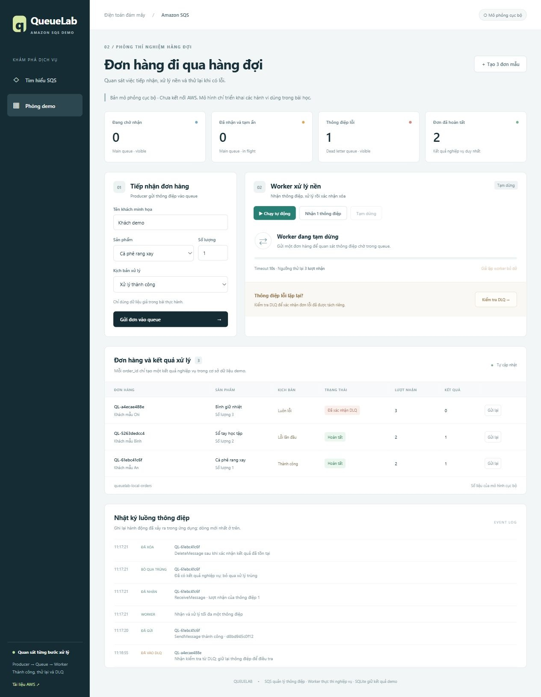
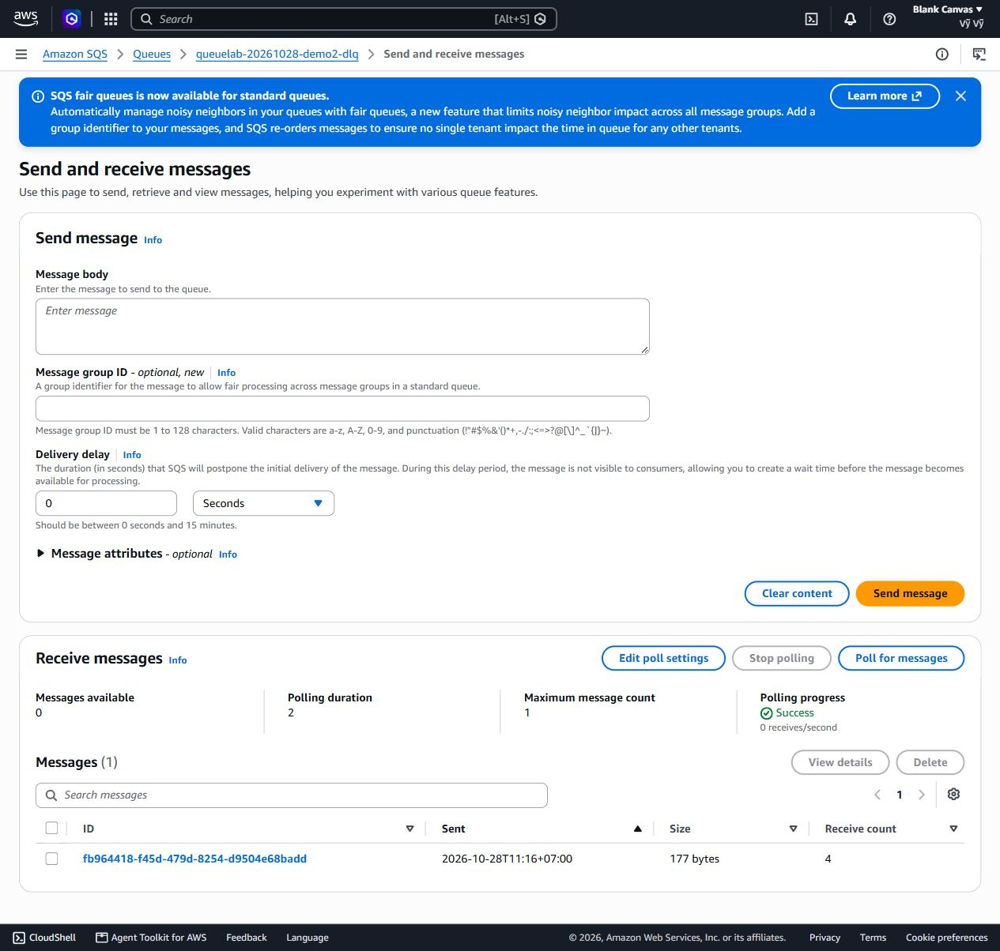

# Amazon SQS — QueueLab

Demo tiếng Việt về hàng đợi xử lý đơn hàng, retry, visibility timeout, DLQ và idempotency. Giao diện giải thích dịch vụ trước khi vào thực hành.

## Tải bộ bàn giao

- [Báo cáo Word 16 trang](Bao_cao_Amazon_SQS_QueueLab.docx): định nghĩa, chức năng, Standard/FIFO, ưu nhược điểm, bảo mật, chi phí; sau đó đến thiết kế, demo và bằng chứng AWS.
- [Sản phẩm demo ZIP](San_pham_demo_SQS.zip): mã nguồn sạch, báo cáo, dàn ý và ảnh minh họa.
- [Dàn ý 10 slide để tự thiết kế](Dan_y_slide_Amazon_SQS.md): lời dẫn, kịch bản demo khoảng 4 phút, câu hỏi dự kiến.
- [Hướng dẫn mã nguồn](sqs-demo/README.md).

## Chạy nhanh

Cần Python 3.10+. Giải nén ZIP rồi mở `sqs-demo/START_DEMO.cmd` trên Windows, hoặc:

```bash
cd sqs-demo
python app.py --open-browser
```

Mở http://127.0.0.1:8081/ và tạo 3 đơn mẫu. Bật worker, chờ khoảng 40 giây, tạm dừng rồi kiểm tra DLQ. Kỳ vọng: 2 kết quả nghiệp vụ, 1 message lỗi trong DLQ. Gửi lại cùng order_id để quan sát effect không tăng. Dừng bằng Ctrl+C.

**Mặc định chạy mô hình cục bộ; chưa kết nối AWS.** Không cần credentials hoặc gói Python ngoài thư viện chuẩn. [Cách chạy backend AWS/CLI](sqs-demo/README.md#chạy-với-amazon-sqs-thật) có trong hướng dẫn.



## Kết quả kiểm chứng

| Phạm vi | Kết quả |
|---|---|
| Mô hình/nghiệp vụ | 20 test đạt: retry, timeout, DLQ, idempotency, crash, ack failure, persistence, validation |
| Adapter AWS | 6 test đạt với fake client; không gọi AWS thật |
| HTTP | 6 test đạt với server loopback và dữ liệu tạm |
| AWS Console thật | Hai Standard queue Sydney; cùng Message ID được nhận 1, 2, 3 lần tại source rồi xuất hiện trong DLQ |
| Chưa thực hiện | Chạy ứng dụng qua Boto3 trên tài khoản AWS; CloudShell của tài khoản đang chờ xác minh |

Chi tiết: [32 test](sqs-demo/tests/verification.json), [biên bản Console](sqs-demo/evidence/aws-console-verification.json).



Console không thực thi behavior trong JSON. Nhận thủ công không xóa dùng để mô phỏng xử lý chưa hoàn tất. Hình local và bằng chứng Console được ghi rõ trong báo cáo; không đánh đồng với một lần chạy tích hợp SDK.

## Cấu trúc

- `sqs-demo/`: Python HTTP API, UI, worker, LocalQueue, AWSQueue và tests.
- `sqs-demo/aws/`: setup có chế độ xem kế hoạch, cấu hình URL/Region, CLI scenarios, IAM runtime policy mẫu.
- `sqs-demo/evidence/`: kết quả kiểm chứng Console, đã lược bỏ account ID.
- Các tài liệu và ảnh ở thư mục gốc để tải nhanh.

Bộ nguồn không chứa credentials, URL queue cá nhân, cơ sở dữ liệu runtime hoặc virtual environment. Khóa idempotency chỉ bao phủ sổ effects SQLite; chưa phải cam kết exactly-once cho hệ thống phân tán hay side effect ngoài ứng dụng.

Hai queue demo `queuelab-20261028-demo2-orders` và `queuelab-20261028-demo2-dlq` ở `ap-southeast-2` được giữ để trình diễn lại. Dừng app AWS sau buổi học để ngừng request thăm dò; chỉ xóa queue sau khi đã lưu bằng chứng và không cần dùng nữa.

## Nguồn chính thức

[Giới thiệu SQS](https://docs.aws.amazon.com/AWSSimpleQueueService/latest/SQSDeveloperGuide/welcome.html), [Standard](https://docs.aws.amazon.com/AWSSimpleQueueService/latest/SQSDeveloperGuide/standard-queues.html), [visibility timeout](https://docs.aws.amazon.com/AWSSimpleQueueService/latest/SQSDeveloperGuide/sqs-visibility-timeout.html), [DLQ](https://docs.aws.amazon.com/AWSSimpleQueueService/latest/SQSDeveloperGuide/sqs-dead-letter-queues.html), [giá AWS](https://aws.amazon.com/sqs/pricing/).

Dàn ý slide của bài SQS được chuẩn bị để người học tự thiết kế. Link Canva bài EC2 trước đó được giữ trong repo EC2, không dùng thay slide của bài này.
